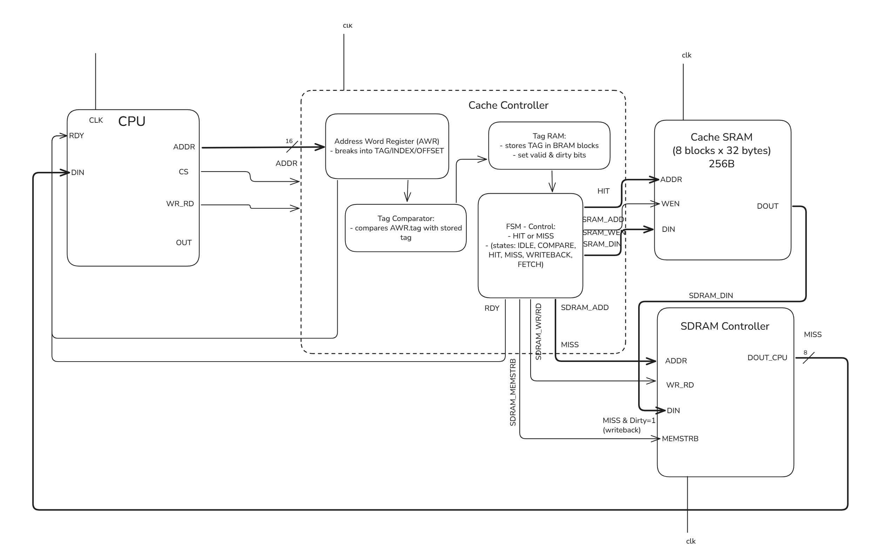

# Write-Back Cache Controller

A direct-mapped write-back cache controller for COE758 at Toronto Metropolitan University, targeting Xilinx Spartan-3E (XC3S500E), that mediates byte-wide read/write transactions between a CPU stimulus generator and SDRAM main memory through a 256 B SRAM cache.

## Block Diagram



## Architecture

### Cache Controller (CACHE_Controller.vhd)
Central FSM that owns tag comparison, valid/dirty-bit maintenance, and orchestrates all data movement. An 8-entry x 8-bit signal array (`memtag`) holds cached tags; two 8-bit vectors (`Vbit`, `Dbit`) track one valid and one dirty bit per cache line.

### Cache SRAM (ipcore_dir/BRAM.vhd)
Xilinx `blk_mem_gen_v6_2` single-port BRAM configured 256 x 8 bit (8 blocks x 32 bytes). The 8-bit SRAM address is formed as `{INDEX[2:0], OFFSET[4:0]}` directly from the CPU address.

### SDRAM Controller (SDRAM_Controller.vhd)
Models main memory as an 8 x 32 byte array initialised to `0xF0`. Responds to `MEMSTRB` with single-byte reads or writes; row = `ADDR[7:5]`, column = `ADDR[4:0]`.

### Address Decomposition (16-bit CPU address)
```
[15:8]  TAG    (8 bits)  -> compared against memtag(INDEX)
[7:5]   INDEX  (3 bits)  -> selects one of 8 cache lines
[4:0]   OFFSET (5 bits)  -> byte within a 32-byte block
```

### Write-Back Policy
On a write hit the dirty bit is set and data is written only to SRAM. A dirty block is flushed to SDRAM only on a compulsory or capacity miss where both `Dbit` and `Vbit` are asserted for the target line, before the replacement fetch begins.

## FSM States

| State (code name) | Encoding | Description |
|-------------------|----------|-------------|
| READY (state4) | `0100` | Latches address; compares tag and Vbit to decide HIT -> state0, dirty miss -> state2, clean miss -> state1 |
| HIT (state0) | `0000` | Write: CPU_Dout -> SRAM, set Dbit. Read: sDout -> CPU_Din. Transitions to IDLE |
| FETCH (state1) | `0001` | Streams 32 bytes SDRAM -> SRAM over 64 cycles (2 cycles/byte); sets Vbit and updates memtag on completion |
| WRITEBACK (state2) | `0010` | Streams 32 bytes SRAM -> SDRAM over 64 cycles; clears Dbit; transitions to FETCH |
| IDLE (state3) | `0011` | Asserts `CPU_RDY`; waits for `CPU_CS` high before re-entering READY |

## Specifications

- Cache: 256 B total, 8 lines x 32 bytes/line, 1 byte/word
- SDRAM: 256 B model, 8 rows x 32 columns, byte-addressable
- Address bus: 16-bit; data bus: 8-bit
- Tag RAM: 8-entry x 8-bit signal array (`memtag`) inside Cache_Controller
- Valid bits: `Vbit(7:0)`, one bit per line
- Dirty bits: `Dbit(7:0)`, one bit per line
- Cache data storage: Xilinx BRAM (blk_mem_gen_v6_2), Spartan-3E family, 256 x 8-bit
- Debug: ChipScope ILA capturing 100-bit bus (CPU address, state, SRAM/SDRAM signals)

## Module Hierarchy

```
Cache_Controller  (CACHE_Controller.vhd)     [top-level FSM]
  +-- CPU_gen          (CPU.vhd)             [read/write transaction stimulus]
  +-- SDRAM_Controller (SDRAM_Controller.vhd)[main memory model, 8x32 bytes]
  +-- SRAM             (ipcore_dir/BRAM.vhd) [256x8 Xilinx BRAM, cache data]
  +-- icon             (ipcore_dir/ICON.vhd) [ChipScope ICON]
  +-- ila              (ipcore_dir/ILA.vhd)  [ChipScope ILA, 100-bit capture]

TEST.vhd          -- simulation testbench, 10 ns clock
resetBlock.vhd    -- staggered reset sequencer (three timed reset outputs)
```

## Tools

- VHDL (IEEE 1076) with Xilinx ISE (`Project1.xise`, target XC3S500E Spartan-3E)
- Xilinx CoreGen (BRAM, ILA, ICON IP cores)
- ModelSim (`TEST.vhd` testbench, `fuse.log` present in project)
